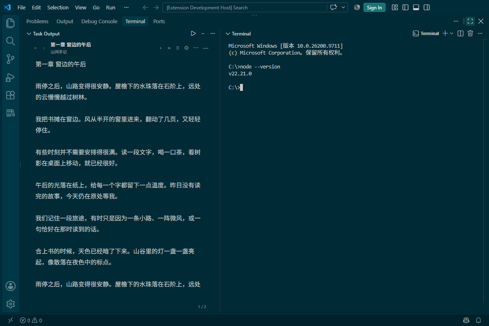
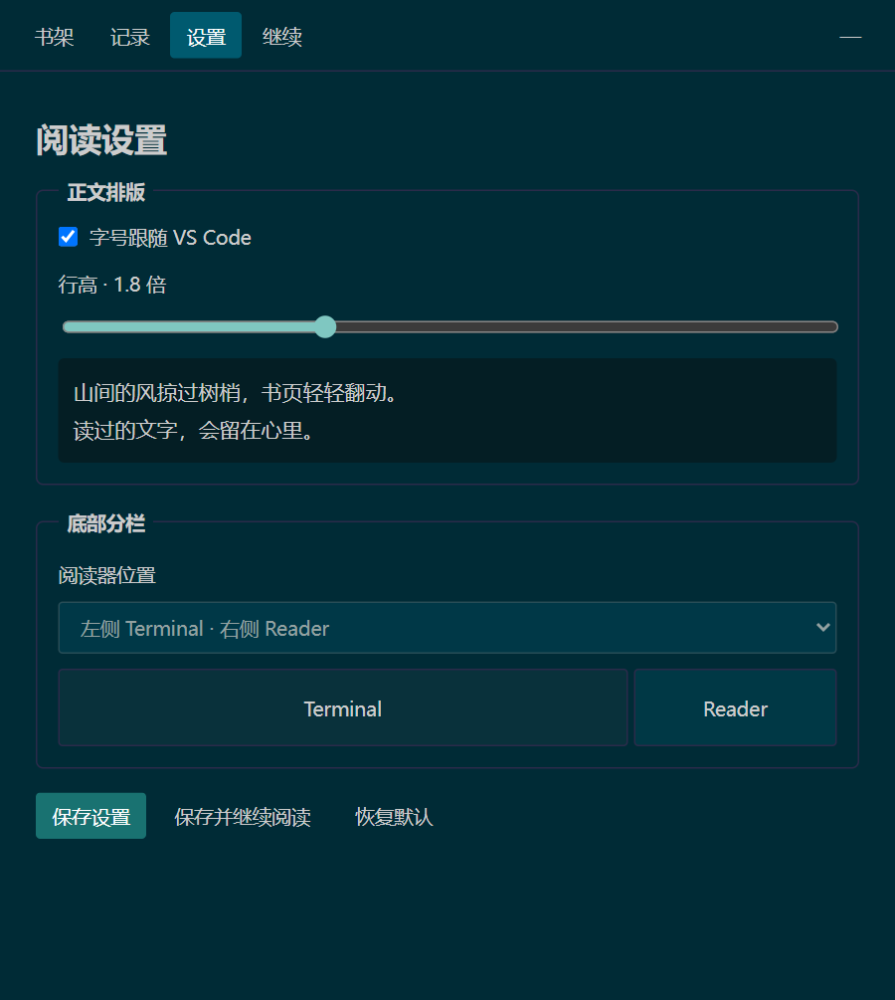

<h1 align="center">📖 Local Reader 本地阅读</h1>

<p align="center">在 VS Code 里，留一段安静的阅读时间。</p>

<p align="center">
  <a href="https://github.com/Dawsonliu0202/vscode-local-reader/releases/latest"></a>
  
  <a href="LICENSE"></a>
</p>

<p align="center">
  <a href="https://github.com/Dawsonliu0202/vscode-local-reader/releases/latest">下载安装包</a> ·
  <a href="#快速开始">快速开始</a> ·
  <a href="#界面预览">界面预览</a> ·
  <a href="#快捷操作">快捷操作</a>
</p>

离线管理和阅读本地 **EPUB / TXT**，支持侧边栏、文件标签页与真实终端分栏。自动保存阅读位置和有效时长，书籍与记录留在本机，无需账号或联网。



<p align="center"><sub>Windows · VS Code 1.144.0 · Solarized Dark。示例中左侧为 Reader，右侧为真实 Terminal；左右位置可在阅读设置中切换。</sub></p>

## 功能一览

| 功能 | 说明 |
| --- | --- |
| 📚 本地书架 | 批量导入、按书名筛选、修改显示名、移除书籍；相同内容自动去重 |
| 🪟 三种阅读模式 | 侧边栏 `Workspace Notes`、文件标签页 `notes.log`、底部 Terminal + Reader 分栏 |
| 👆 轻量翻页 | 左右点击分区、方向键与翻页按钮；目录自动定位并高亮当前章节 |
| 🔖 进度恢复 | 自动保存正文位置，调整字号、窗口宽度或阅读模式后继续阅读 |
| 📊 阅读统计 | 今日、最近 7 天、累计与单书时长；同书同日的阅读记录合并展示 |
| ⚙️ 简洁设置 | 字体跟随 VS Code，调整字号、行高和底部分栏位置，实时预览 |
| ⌨️ 快速隐藏 | 一键清除插件正文和管理页面，保留代码文件与真实终端 |

## 快速开始

1. 在 [Releases](https://github.com/Dawsonliu0202/vscode-local-reader/releases/latest) 下载 `.vsix` 安装包。
2. 打开 VS Code 扩展视图，点击右上角 **`…` → 从 VSIX 安装**，选择下载的安装包。
3. 点击左侧活动栏的 **Local Reader 书本图标**，在书架点击 **导入书籍**，选择 `.epub` 或 `.txt`。
4. 点击书名或 **继续** 开始阅读；以后按 `Ctrl+Alt+R` 恢复，按 `Ctrl+Alt+H` 隐藏。

**旧版可直接覆盖升级，书库与阅读记录保留。** 无需打开项目文件夹，也无需运行 npm。

## 界面预览

以下是当前版本 Webview 的实际渲染截图，使用示例书籍和演示统计数据；上方分栏图截自实际运行的 VS Code。

### 书架管理

书籍、进度、累计时长和最近阅读时间集中展示，导入入口只在书架出现。


<table>
  <tr>
    <th width="50%">阅读记录与时长</th>
    <th width="50%">阅读设置</th>
  </tr>
  <tr>
    <td valign="top"></td>
    <td valign="top"></td>
  </tr>
  <tr>
    <td>同书同日合并记录，保留日期、累计时长和可确定的起止进度。</td>
    <td>排版与分栏即时预览，支持保存、恢复默认及保存并继续阅读。</td>
  </tr>
</table>

## 快捷操作

| 操作 | 快捷键 / 鼠标 |
| --- | --- |
| 继续最近一本书 | `Ctrl+Alt+R` |
| 隐藏所有插件内容 | `Ctrl+Alt+H`，或右上角 `—` |
| 正文内快速隐藏 | `Esc`；目录或菜单打开时先关闭弹层 |
| 上一页 / 下一页 | `←` / `→`、顶部 `‹` / `›`，或点击正文左右分区 |
| 上一章 / 下一章 | `Alt+←` / `Alt+→`，或顶部 `«` / `»` |
| 打开目录 | 顶部 `≡`；自动定位并高亮当前阅读章节 |
| 调整字号、行高与分栏 | 顶部 `⚙`，或管理页的 **设置** |
| 切换阅读模式、书架与统计 | 顶部 `⋯` 菜单或命令面板 |

**点击分区：** 正文左侧三分之一为上一页，右侧三分之一为下一页，中间区域不翻页。拖动选字、清除已有选区及菜单打开时的背景点击不会误翻页。滚轮、上下方向键、PageUp/PageDown 和空格不翻页。

顶部显示章节和书名，底部显示 **本章当前页 / 总页数**。页码随字号和阅读区域变化，保存的位置按正文字符确定。普通翻页键仅在正文内生效，不接管代码编辑器和真实终端输入。

macOS 打开/隐藏对应 `Cmd+Option+R/H`；键位可在 VS Code 的“键盘快捷方式”中修改，平台兼容性范围见下方说明。

## 格式与数据

- **TXT**：支持 UTF-8、GBK/GB18030；编码回退时可先预览再确认。
- **EPUB**：支持无 DRM 的 EPUB 2/3 文字书，提取正文和目录，使用统一排版。
- **大小与副本**：每本上限 50 MiB；导入保存本地副本，原文件移动后仍可阅读。
- **时长口径**：仅在窗口前台、正文可见且最近 120 秒内有正文操作时累计。隐藏、失焦或空闲暂停；短于一分钟显示秒数，跨日按本地日期拆分。
- **移除书籍**：删除插件副本、进度、记录与该书累计时长，原始文件保留。

<details>
<summary><strong>数据存放与恢复</strong></summary>

数据保存在 VS Code 分配的 `globalStorageUri` 中，不写入项目，不开启遥测，也不加入 Settings Sync。

Windows 默认目录通常为 `%APPDATA%/Code/User/globalStorage/workspace-tools.local-reader/`；便携版或其他用户配置以 VS Code 实际位置为准。

| 文件 | 用途 |
| --- | --- |
| `state.json` | 书架、进度与原始阅读会话 |
| `state.json.bak` | 上一份完整状态备份 |
| `books/` | 导入副本与正文缓存 |

缓存缺失时从副本重建，状态损坏时尝试备份；两者均损坏会保留目录并报错。多窗口写入使用文件锁，重新打开书架可读取最新数据。异常退出可能丢失最近一个检查点，通常不超过 10 秒。

隐藏会清空插件内容、关闭自身阅读标签、收起书架并移除底部阅读分栏；真实终端和其他文件保留。重启后需主动继续阅读，不自动展示正文。本功能不提供系统级隐藏或磁盘数据加密。

</details>

<details>
<summary><strong>终端分栏与快捷键设置</strong></summary>

底部模式使用原生 Terminal 与阅读 Webview，分隔条可拖动，左右位置可在阅读设置中切换。插件复用已有终端，没有时创建默认终端，不会向 Shell 自动输入命令。文件页是只读 Webview，不创建真实项目文件。

如果手动移动过视图，重新选择底部模式可恢复容器位置；容器中额外放入其他扩展视图时，可通过 VS Code 拖动整理。

若自定义了 `terminal.integrated.commandsToSkipShell`，请在原有数组中加入 `localReader.resume` 和 `localReader.hide`。`terminal.integrated.sendKeybindingsToShell` 也可能影响终端内快捷键路由。[VS Code 官方说明](https://code.visualstudio.com/docs/terminal/advanced#_keybinding-and-the-shell)

</details>

<details>
<summary><strong>支持环境与范围</strong></summary>

支持 VS Code 桌面版 **1.95 及以上**，当前主要验证环境为 **Windows / VS Code 1.144.0**。macOS、Linux、浏览器版、Remote/WSL/SSH 与 Codespaces 尚未进行兼容性验收。

当前支持 EPUB/TXT 文字阅读，不包含 PDF、MOBI、DRM 解密、固定版式、扫描书、原版插图与复杂排版还原，也不提供在线书城和云同步。

</details>

## 开发与验证

需要 Node.js 22 或更新的受支持版本，以及 npm。克隆项目后执行：

```sh
npm ci
npm run check
npm test
npm run build
npm run test:ui
npm run test:host
npm run package
```

`test:ui` 使用本机 Microsoft Edge 无头运行；`test:host` 使用隔离的 VS Code 配置，不向日常书架写入测试内容。也可用 `VSCODE_EXECUTABLE_PATH` 指定已有 `Code.exe`，Windows 下可按 F5 调试插件。

| 文档 | 内容 |
| --- | --- |
| [功能 PRD](docs/PRD.md) | 功能与范围约定 |
| [实现方案](docs/IMPLEMENTATION_PLAN.md) | 模块、存储与阅读流程 |
| [验收记录](docs/VERIFICATION.md) | 已执行验证及兼容性范围 |
| [更新记录](CHANGELOG.md) | 各版本变更 |

## 许可证

[MIT](LICENSE) · 运行时依赖声明见 [THIRD_PARTY_NOTICES.txt](THIRD_PARTY_NOTICES.txt)。
